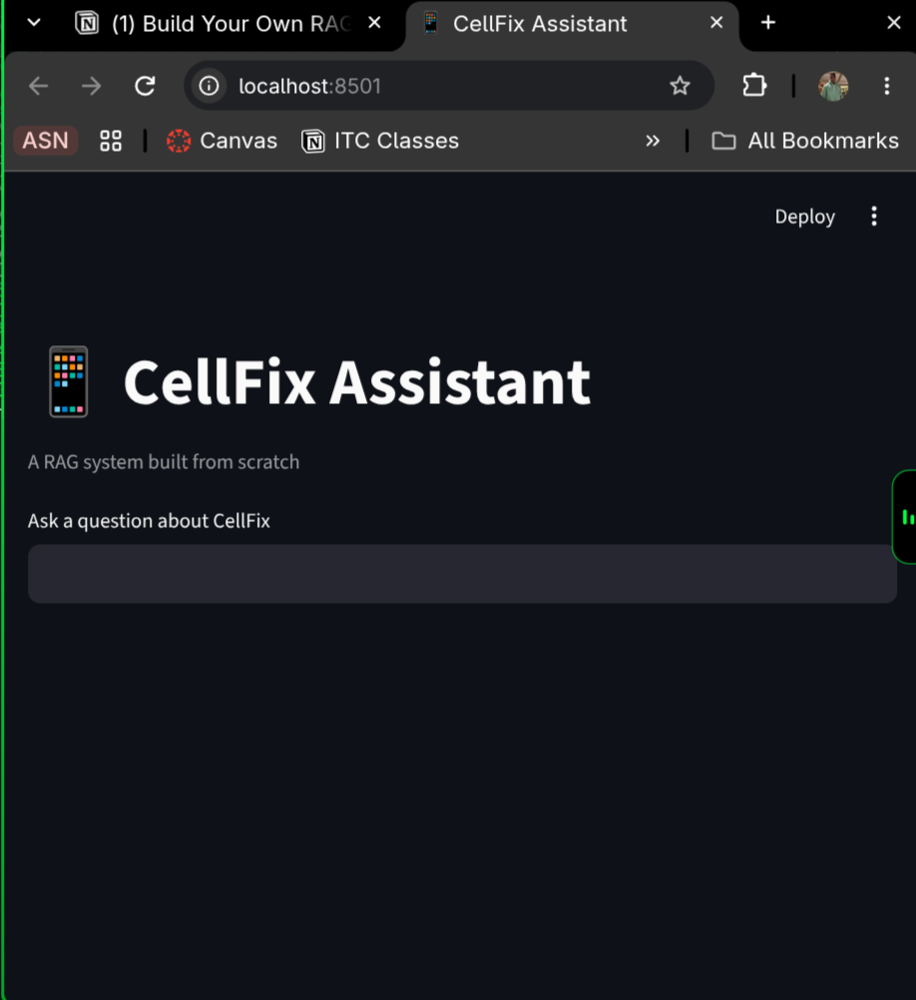

# RAG from Scratch 💻

A Retrieval Augmented Generation (RAG) system built step by step in plain
Python — embeddings, chunking, vector search, and prompting — then
re-implemented with LangChain for comparison.

It answers questions about a fictional e-bike company, Lumen Cycles,
using only its internal documents, and cites its sources.

## How it works
1. **Ingest** — documents in `data/` are split into overlapping chunks
2. **Embed** — each chunk becomes a vector via an embedding model
3. **Store** — vectors are saved in a local ChromaDB database
4. **Retrieve** — a question is embedded and the closest chunks are found
5. **Generate** — the chunks are passed to an LLM with instructions to
   answer only from that context

## Quick start
    python3 -m venv .venv && source .venv/bin/activate
    pip install -r requirements.txt
    cp .env.example .env        # add your OpenAI key (or Ollama settings)
    python -m rag.ingest        # build the index
    python ask.py               # start asking questions

## Cellfix RAG UI

## What I learned
I learned how RAG actually works. Before this I believed it just meant giving temporary files to a chatbot, which would then repeat the information in those documents back to you.

It works differently. The model has no idea what the company is, so RAG fixes that by handing it the right documents at the right time, through chunking and embedding. Embedding matches the meaning of each input through vector mapping. Chunking breaks the documents into smaller pieces so the model can process the information within its token limit. Retrieval is half the battle: the model can only answer from the chunks it's given, which is why the Streamlit app shows the retrieved chunks.

What surprised me was that local Ollama models behave differently from OpenAI's. Their vectors have only 768 numbers instead of 1536, and the choice between cosine and L2 distance matters a lot.

## Acknowledgements
Inspired by Abhishek Veeramalla's
[RAG crash course](https://github.com/iam-veeramalla/RAG-crash-course).
